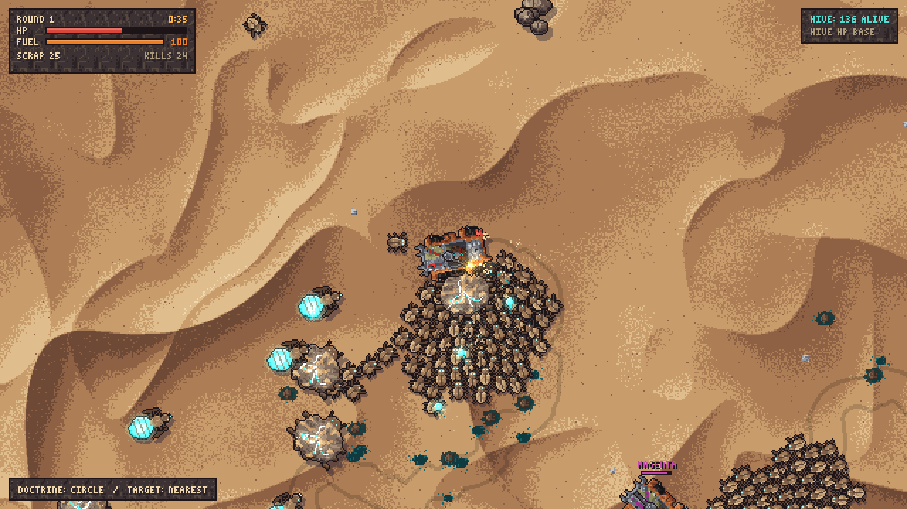
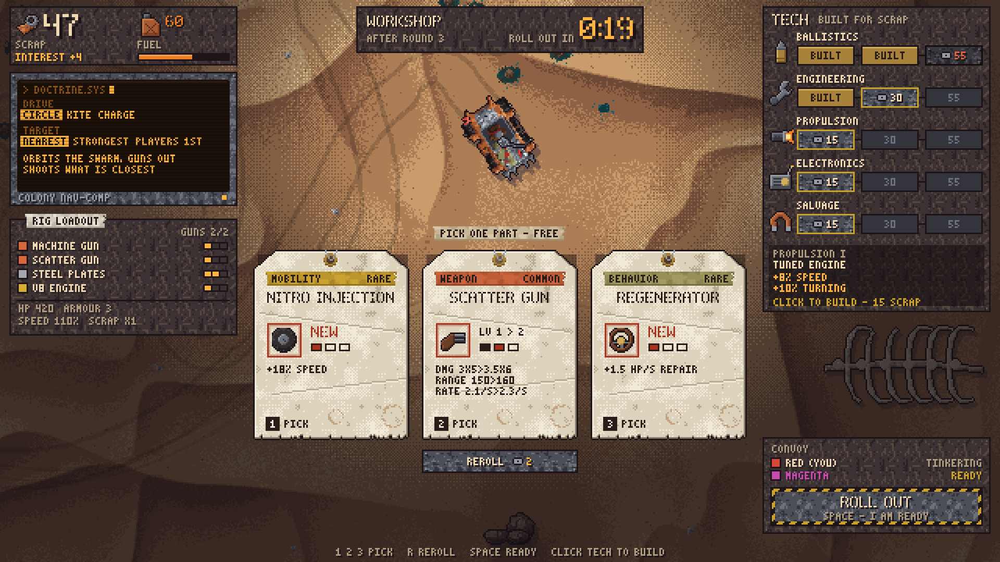
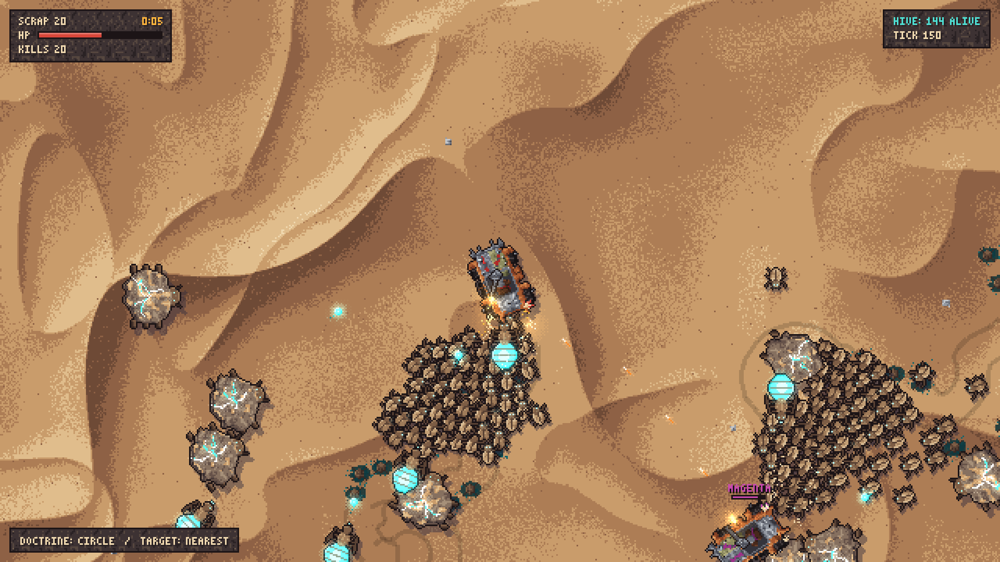
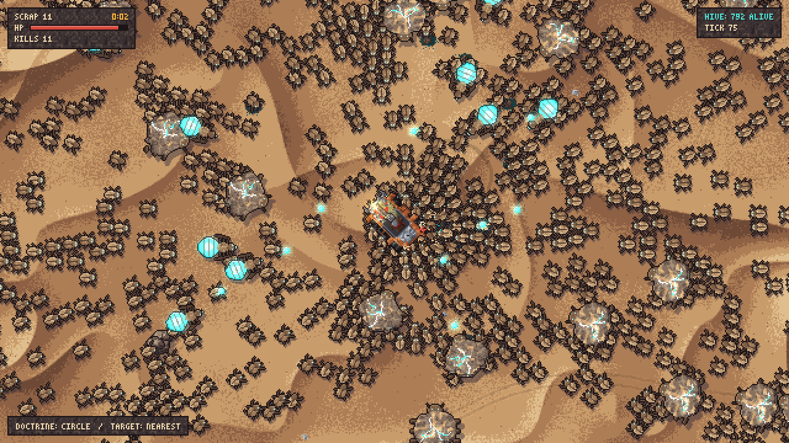
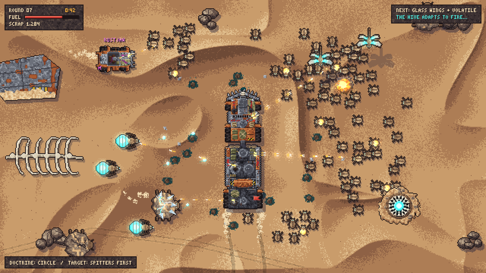
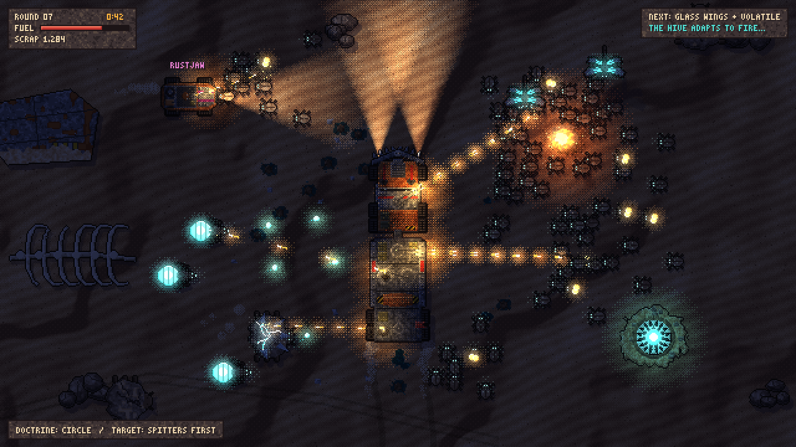

# BulletHwaven

A multiplayer **PvPvE auto-battler survivor**. AI-driven, scrap-welded war rigs fight alien hordes, and each other, on a desert planet. Steer the battle through roguelike upgrade drafts, a tech tree and **AI doctrine**: the last convoy standing wins.

> Status: pre-production. The design and art direction are drafted, and a playable Godot 4 prototype exists: rounds with a workshop phase (card draft, tech tree, AI doctrine), fuel reserves and last-convoy-standing, LAN multiplayer, and headless tests (see [`docs/architecture.md`](docs/architecture.md)).

**In-game, current build:**

| Combat | Workshop (between rounds) |
|---|---|
|  |  |
|  |  |

**Art-style target:**

| Day | Night |
|---|---|
|  |  |

## Repository layout

| Path | What's in it |
|---|---|
| [`game/`](game/) | Godot 4.7 project: `sim/` (deterministic simulation), `net/` (LAN multiplayer), `render/`, `tools/`, `tests/` |
| [`docs/architecture.md`](docs/architecture.md) | Tech stack decision and the layer and API contract |
| [`scripts/`](scripts/) | `setup-godot.sh` (installs the pinned Godot), `test.sh`, `shot.sh`, `lan-smoke.sh` |
| [`docs/game-design.md`](docs/game-design.md) | Game design document: core loop, vehicle grid, draft and tech tree, AI doctrine, enemy variety, PvP, meta progression, art direction |
| [`art/samples/`](art/samples/) | Art-style samples: mock-up screenshots (day/night), sprite sheet, biome tiles, palette |
| [`tools/artgen/`](tools/artgen/) | Python generator that draws the sample art procedurally from the master palette |

## Running the game

Install [Godot 4.7.2](https://godotengine.org/download) (or run `scripts/setup-godot.sh` on Linux), then:

```bash
godot --path game                         # solo
godot --path game -- --host               # host a LAN game
godot --path game -- --join=192.168.1.20  # join a LAN game
scripts/test.sh                           # headless tests
scripts/shot.sh <scenario> <seed> <ticks> out.png   # screenshot a scenario
```

Or open `game/project.godot` in the Godot editor.

## Art-style samples

- `mockup_day.png` / `mockup_night.png`: an in-game mock-up at 640×360 native, rendered ×3 (1920×1080)
- `mockup_day_1x.png`: the same frame at native resolution, to judge the real pixel scale
- `sprites.png`: vehicles, aliens at rest vs. active, mutations, props
- `biomes.png`: the six biomes (Dune Sea, Salt Flats, Canyon, Glass Crater, Wreck Field, Spore Basin)
- `palette.png`: the master palette ramps

Regenerate them with:

```bash
pip install -r tools/artgen/requirements.txt
python tools/artgen/generate.py            # --scale N for a different upscale
```

These are **placeholder / style-target art**, generated from code to pin down the palette, the readability rules and the scale. Final art would be hand-pixelled on top of these rules.
